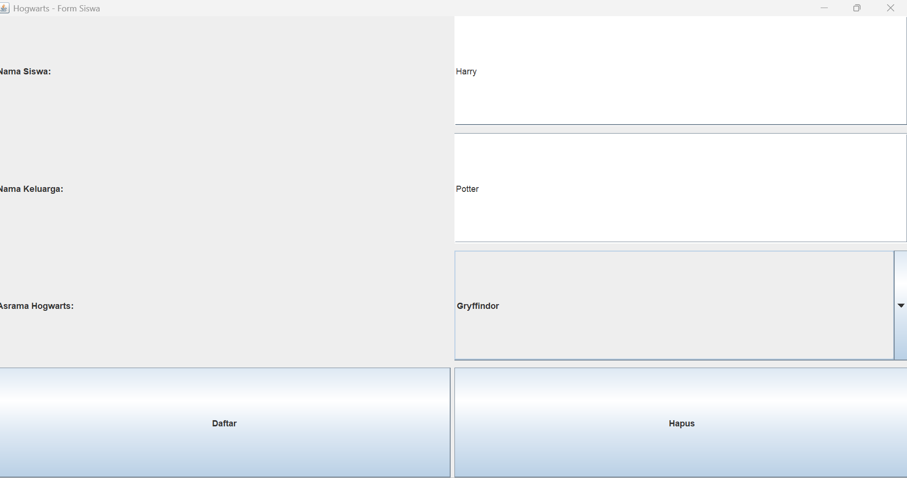
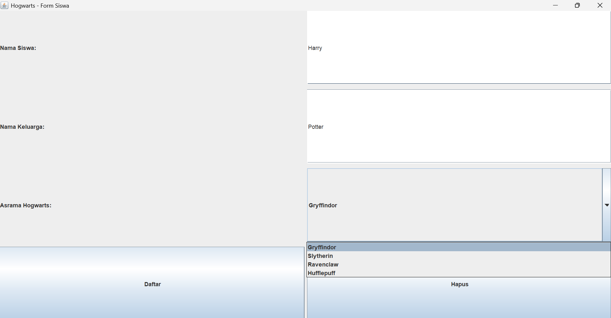
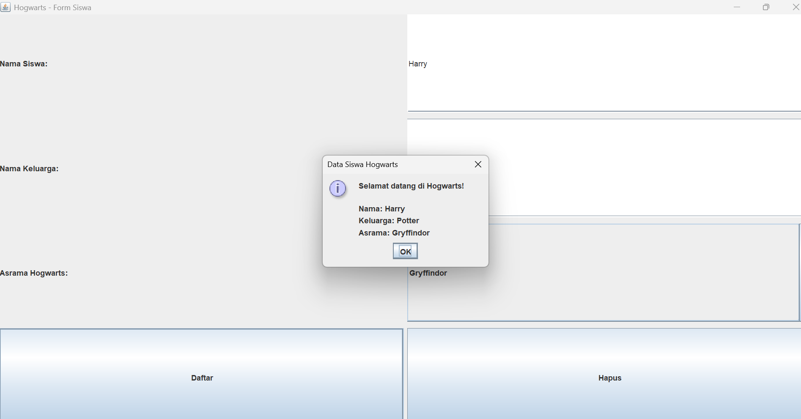
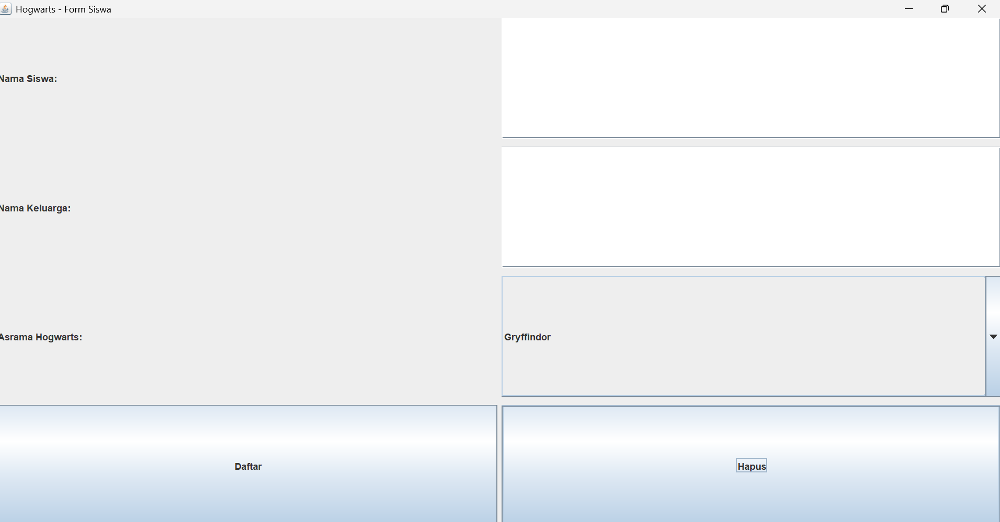

# Form Siswa Hogwarts

 GUI sederhana menggunakan Java Swing untuk pendaftaran siswa Hogwarts. Pengguna dapat mengisi nama siswa, nama keluarga/marga, memilih asrama, lalu menampilkan data siswa melalui tombol Daftar.

## 1. Komponen GUI

### Top-Level Container
`JFrame` digunakan sebagai jendela utama aplikasi dengan judul "Hogwarts - Form Siswa".

### Intermediate Component
`JPanel` digunakan untuk menampung dan mengatur komponen-komponen pada form.

### Atomic Component
- `JLabel` untuk memberikan keterangan setiap input.
- `JTextField` untuk mengisi nama siswa dan nama keluarga.
- `JComboBox` untuk memilih asrama Hogwarts.
- `JButton` untuk tombol Daftar dan Hapus.
- `JOptionPane` untuk menampilkan data siswa dalam dialog.

### Layout Manager
`GridLayout(4, 2, 5, 10)` digunakan untuk mengatur komponen dalam 4 baris dan 2 kolom.

### Event Handling
Program menggunakan dua interface Java dalam event handling, yaitu:

- **ActionListener**, digunakan untuk menangani klik tombol Daftar dan Hapus. Tombol Daftar menampilkan data siswa, sedangkan tombol Hapus mengosongkan form dan mengembalikan pilihan asrama ke pilihan pertama.
- **ItemListener** tidak digunakan dalam program ini. Interface kedua yang digunakan adalah **ActionListener** untuk kedua tombol tersebut.

## 2. Screenshot

### Tampilan Input

### Pilihan Asrama

### Tampilan Data Siswa Setelah Menekan Daftar

### Tampilan Form Setelah Menekan Hapus
